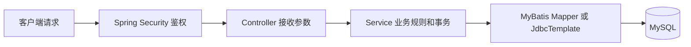

# 城市路线打卡后端实现讲解

## 1. 一次请求如何到达数据库

`ApiController` 把 HTTP 请求转换为 Java 参数；`ProjectService` 验证业务规则并控制事务；`RouteMapper` 使用 MyBatis 查询路线；其他写操作通过 `JdbcTemplate` 执行带参数的 SQL。响应对象只包含接口需要的字段，查询中不返回密码哈希。

路线列表是读请求：`GET /api/routes?keyword=散步&q=公园` 进入 `ApiController.routes`，由 `ProjectService.listRoutes` 检查分页参数，再由 `RouteMapper.listPublished` 拼接必要的查询条件。MyBatis 的 `#{...}` 将输入作为参数绑定，不把用户文本拼成 SQL 片段。

路线发布是写请求：Controller 接受路线、点位 ID 列表和关键词 ID 列表；Service 检查点位数量、重复值、活动有效期和官方角色；数据库事务写入路线主表、路线点位联系表和路线关键词联系表。任何一步失败，整次发布回滚，不会留下半条路线。

## 2. 用户与权限

用户注册时用 BCrypt 保存密码哈希，账号状态先设为 `PENDING`。管理员审核后变为 `ACTIVE`，才能通过 HTTP Basic 访问受保护接口。每次请求的用户名和密码由 Spring Security 校验；`/api/auth/me` 可用来验证登录并查看当前账号。管理员接口限制为 `ROLE_ADMIN`；发布官方限时活动还需 `OFFICIAL` 角色。此版本使用无状态 HTTP Basic，适合课程 API 演示；部署时必须使用 HTTPS。

首次管理员由环境变量 `APP_ADMIN_USERNAME`、`APP_ADMIN_PASSWORD` 创建。角色定义由 V3 数据迁移插入，管理员账号不写死在 SQL 文件里。

## 3. 积分和商城为什么需要事务

积分余额不另存一份，而是 `point_ledger.change_points` 的总和。首次点赞、收藏会生成发布者奖励流水；取消后再点赞不会重复奖励。打卡由 `route_checkin(user_id, route_id)` 唯一约束保证最多一次。

路线自设的打卡额外积分由发布者余额支付。打卡事务先锁发布者用户行，再检查余额，并写一条负数流水和一条正数流水。官方人员也用同一逻辑，管理员可给官方账号配置活动预算。奖励规则从 `point_rule` 读取，因此以后调整规则不会改写历史流水。

兑换事务锁定用户和商品，检查余额、库存，随后扣库存、创建订单、写负数积分流水。取消待领取订单时恢复库存并写正数退款流水。订单保存当时的积分单价，商品后来改价不会改变历史订单。

## 4. 数据库对象与课程要求

- V1/V2：15 张基础表，包含主外键、唯一约束和索引。
- V3：三种角色、三条固定积分奖励规则。
- V4：余额函数 `fn_user_points`，关闭路线的存储过程 `sp_close_published_route`，维护点赞更新时间的触发器 `tr_route_like_updated`。
- V5：公开路线统计视图 `v_public_route_stats` 和后台兑换视图 `v_admin_redemptions`。接口权限由 Spring Security 控制。
- 排行榜：收藏排行统计有效收藏；用户排行汇总积分流水；点位排行统计经过该点的路线被打卡次数。点位榜不表示用户 GPS 实地到访。
- Word 统计报表：`GET /api/admin/reports/rankings.docx` 使用 Apache POI 导出三个排行榜。

Flyway 在应用启动时按版本执行迁移。已经执行过的脚本不应修改；后续修改结构需新增更高版本文件。

## 5. 验证方法

1. ` .\mvnw.cmd test `：需要本机 MySQL 已启动且当前终端设置 `DB_PASSWORD`。其中兑换集成测试在事务中创建测试用户与商品，检查兑换扣分扣库存、取消退款恢复库存。
2. `GET /hello`、`GET /api/routes`：验证服务与公开查询。
3. 管理员初始化后调用 `GET /api/auth/me`、`GET /api/admin/users/pending`：验证身份和权限。
4. 依 README 的演示顺序跑完整业务链，最后下载 Word 排行榜报表。

若启动在 V3、V4 或 V5 失败，以 Flyway 输出的第一个 SQL 错误为准排查。不要删除或手改 `flyway_schema_history`；迁移成功后再继续业务测试。
